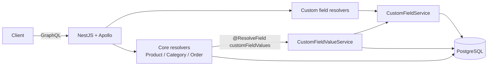

# 🛍️ ShopOS — Headless E-commerce API with Runtime Custom Fields

[](https://github.com/kmin344/shopOS/actions/workflows/ci.yml)

ShopOS is a headless e-commerce backend built on **NestJS, GraphQL (Apollo) and TypeORM/PostgreSQL**.

The problem it targets: store owners on fixed SaaS platforms can't add their own data to products or orders without waiting for the vendor. In ShopOS, a store can define new fields (say, "Color" on products or "Gift message" on orders) **at runtime, through the API**, and those fields are immediately readable and writable through GraphQL — no migration, no redeploy.

## What works today

- **Core catalog and orders**: GraphQL queries and mutations for products, categories and orders. Order totals are computed server-side from product prices.
- **Runtime custom fields**: define typed fields (`STRING`, `NUMBER`, `BOOLEAN`, `DATE`, `ENUM`) per entity type, set values per entity, and read them back on `Product`, `Category` and `Order` through a shared `HasCustomFields` GraphQL interface.
- **REST + OpenAPI** alongside GraphQL, with Swagger UI at `/api`.
- **Tests**: unit tests for the custom-field logic and end-to-end tests that run the full GraphQL flow against a real Postgres database. Both run in CI on every push.

## How custom fields work



Field **definitions** (`CustomField`) and field **values** (`CustomFieldValue`) live in their own tables, keyed by entity type and entity ID. The core entities don't change shape when a store adds a field; instead, each core type has a field resolver that loads the values defined for its entity type. This is an entity-attribute-value design, chosen so stores can extend the schema without database migrations.

## Run it locally

Requires Node.js 18+ and Docker.

```bash
cd shopos
docker compose up -d          # Postgres on localhost:5432
cp .env.example .env
yarn install
yarn start:dev
```

- GraphQL playground: http://localhost:3000/graphql
- Swagger UI: http://localhost:3000/api

Run the tests:

```bash
yarn test        # unit tests
yarn test:e2e    # end-to-end, needs the Postgres container running
```

## Example

```graphql
# 1. Define a new field for products
mutation {
  createCustomField(input: { name: "Color", fieldType: STRING, entityType: PRODUCT, isRequired: false }) {
    id
  }
}

# 2. Set it on a product
mutation {
  setCustomFieldValue(entityId: "<product-id>", customFieldId: "<field-id>", value: "black") {
    id
  }
}

# 3. Read it back alongside the core fields
query {
  products {
    name
    price
    category { name }
    customFieldValues { value customField { name fieldType } }
  }
}
```

## Project layout

```
shopos/src
├── core/            products, categories, orders (entities, services, resolvers, REST controllers, DTOs)
├── custom-field/    custom field definitions, values, and the HasCustomFields interface
├── connector/       placeholder for third-party integrations (see roadmap)
└── common/          GraphQL scalars and the decimal column transformer
```

## Roadmap

These are part of the original design but are **not implemented in this repository yet**:

- **Connectors** — a standard interface for payment gateways and other third-party providers (the `connector` module is a placeholder).
- **Admin UI** — a dashboard for defining custom fields without writing GraphQL.
- **Frontend SDK** — an npm package for typed access to a store's schema.
- **Validation of custom field values** against their declared type and enum options.

<details>
<summary>Admin dashboard design</summary>


</details>

## License

[MIT](LICENSE)
