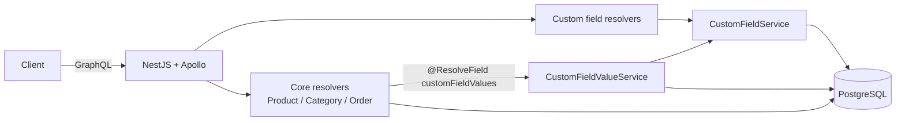

# 🛍️ ShopOS — Headless E-commerce API with Runtime Custom Fields

[](https://github.com/kmin344/shopOS/actions/workflows/ci.yml)

ShopOS is a headless e-commerce backend built on **NestJS, GraphQL (Apollo) and TypeORM/PostgreSQL**.

The problem it targets: store owners on fixed SaaS platforms can't add their own data to products or orders without waiting for the vendor. In ShopOS, a store can define new fields (say, "Color" on products or "Gift message" on orders) **at runtime, through the API**, and those fields are immediately readable and writable through GraphQL — no migration, no redeploy.

## What works today

- **Core catalog and orders**: GraphQL queries and mutations for products, categories and orders. Order totals are computed server-side in integer cents, so they are exact. Inputs are validated (UUIDs, prices to two decimals and within the column's range, no duplicate products in an order). Reads, updates and deletes of missing records return not-found errors (404 over REST), custom field values can only be set on records that exist, and deleting a category that still has products returns 409.
- **Runtime custom fields**: define typed fields (`STRING`, `NUMBER`, `BOOLEAN`, `DATE`, `ENUM`) per entity type, set values per entity, and read them back on `Product`, `Category` and `Order` through a shared `HasCustomFields` GraphQL interface.
- **REST + OpenAPI** alongside GraphQL, with Swagger UI at `/api`.
- **Tests**: unit tests for the custom-field logic and end-to-end tests that run the GraphQL and REST flows against a real Postgres database. Both run in CI on pull requests and on pushes to `main`.

- **Orders with quantities and stock**: an order has lines of `{ productId, quantity }`. The unit price is copied at order time. Placing an order takes stock in one database transaction with row locks, so concurrent orders cannot oversell (`409` when stock is too low). Cancelling a `PENDING` or `PROCESSING` order returns the stock once. A cancelled order cannot be reopened, and a shipped or delivered order cannot be cancelled. Deleting an order does not change stock, so cancel first. A product that appears in an order cannot be deleted (`409`).
- **Custom field validation**: values must match the field type (`NUMBER`, `BOOLEAN` as `true`/`false`, `DATE` as ISO 8601, `ENUM` from its options). Required fields reject empty values. An `ENUM` field must define options, and a default value must be valid.

- **Payments through connectors**: a `PaymentConnector` interface (`shopos/src/connector/payment-connector.ts`) with a Stripe implementation over the REST API. `createPayment(orderId, provider)` starts a payment for the order total and returns the provider's client secret. Providers report results to `POST /webhooks/payments/<provider>`, which checks the signature over the raw body. A successful payment moves the order from `PENDING` to `PROCESSING`. Repeated webhooks change nothing. Provider errors are logged and the caller gets a generic `502`. An order with payment records cannot be deleted (`409`).

- **Admin API keys**: every operation needs `Authorization: Bearer <key>` with a key from `ADMIN_API_KEYS`, except the storefront operations listed below. New endpoints are closed unless marked `@Public()`.

- **Admin page** at `/admin`: list, create and delete custom fields without writing GraphQL. Enter an admin key on the page. The key stays in the browser tab's session storage until you disconnect or close the tab. The page is served with a strict Content Security Policy.

- **TypeScript SDK** in [`sdk/`](sdk/README.md): a typed client for the storefront flow, plus `shopos-sdk types`, which generates types for a store's own custom fields. Tested against the live API in the e2e suite. Not published to npm yet.

## Authentication

| Open to everyone (storefront) | Needs an admin key |
|---|---|
| Read products, categories and custom field definitions | Create, update and delete products, categories and custom fields |
| Place an order (`createOrder`, `POST /orders`) | Set custom field values |
| Read one order by its ID | List all orders, change order status, delete orders |
| Start a payment, list an order's payments | |
| Payment webhooks (checked by provider signature), `/health`, `/ready` | |

`ADMIN_API_KEYS` takes a comma-separated list, so you can add a new key, move clients to it, then remove the old one. With no keys set, every admin call is refused. Generate a key with `openssl rand -hex 32`. In production (`NODE_ENV=production`) the GraphQL playground is off.

## How custom fields work



Field **definitions** (`CustomField`) and field **values** (`CustomFieldValue`) live in their own tables, keyed by entity type and entity ID. The core entities don't change shape when a store adds a field; instead, each core type has a field resolver that loads the values defined for its entity type. This is an entity-attribute-value design, chosen so stores can extend the schema without database migrations.

## Run it locally

Requires Node.js 20+ and Docker.

```bash
cd shopos
docker compose up -d          # Postgres on localhost:5432
cp .env.example .env          # database settings, read at startup
yarn install
yarn start:dev
```

- GraphQL playground: http://localhost:3000/graphql
- Swagger UI: http://localhost:3000/api

Run the tests:

```bash
yarn test        # unit tests
yarn test:e2e    # end-to-end, needs the Postgres container running
```

The e2e suite drops and recreates its tables, so it always runs against a separate `shopos_test` database, which it creates on first run. It refuses to run against any database whose name doesn't end in `_test`.

## Database migrations

The schema comes only from migrations in `shopos/src/database/migrations`. `synchronize` is always off.

- The app applies pending migrations at startup. With more than one replica, run `yarn migration:run` as a deploy step and set `DB_MIGRATIONS_RUN=false` on the app.
- After you change an entity, generate a migration: `yarn migration:generate src/database/migrations/<Name>`.
- CI applies the migrations to an empty database and fails if the entities and migrations differ (`yarn migration:check`). The e2e suite also builds its schema from the migrations.

## Deploy

```bash
docker build -t shopos shopos
docker run -p 3000:3000 -e DB_HOST=... -e DB_PASSWORD=... -e DB_SSL=true shopos
```

Or run the full stack locally: `cd shopos && docker compose --profile app up --build`.

| Variable | Default | Notes |
|---|---|---|
| `DB_HOST`, `DB_PORT`, `DB_USERNAME`, `DB_PASSWORD`, `DB_NAME` | `localhost`, `5432`, `postgres`, `postgres`, `shopos` | |
| `DB_SSL` | `false` | Set `true` for managed Postgres. |
| `DB_MIGRATIONS_RUN` | `true` | Set `false` when a deploy step runs migrations. |
| `PORT`, `HOST` | `3000`, `0.0.0.0` | |
| `STRIPE_SECRET_KEY`, `STRIPE_WEBHOOK_SECRET` | unset | Both set = Stripe enabled. Webhook URL: `/webhooks/payments/stripe`, events `payment_intent.succeeded`, `payment_intent.payment_failed`, `payment_intent.canceled`. |
| `SHOP_CURRENCY` | `usd` | ISO currency code sent to the provider. |
| `ADMIN_API_KEYS` | unset | Comma-separated admin keys. Unset = no admin access. |

`GET /health` is liveness. `GET /ready` also queries the database and returns `503` when it is down. The image runs as a non-root user.

## Example

```graphql
# 1. Define a new field for products
mutation {
  createCustomField(input: { name: "Color", fieldType: STRING, entityType: PRODUCT, isRequired: false }) {
    id
  }
}

# 2. Set it on a product
mutation {
  setCustomFieldValue(entityId: "<product-id>", customFieldId: "<field-id>", value: "black") {
    id
  }
}

# 3. Read it back alongside the core fields
query {
  products {
    name
    price
    category { name }
    customFieldValues { value customField { name fieldType } }
  }
}
```

## Project layout

```
shopos/src
├── core/            products, categories, orders (entities, services, resolvers, REST controllers, DTOs)
├── custom-field/    custom field definitions, values, and the HasCustomFields interface
├── connector/       placeholder for third-party integrations (see roadmap)
└── common/          GraphQL scalars and the decimal column transformer
```

## Known limits

- Refunds are not implemented. Cancelling a paid order returns the stock but does not refund the payment. If a payment succeeds after its order was cancelled, the payment is stored as `SUCCEEDED` and the order stays `CANCELLED`; refund it in the provider dashboard.
- Anyone can place an order, and an unpaid order holds its stock until an admin cancels it. There is no automatic expiry of unpaid orders and no rate limiting yet.
- Order IDs are random UUIDs and work as the customer's access to the order. There are no customer accounts.
- Stripe is the only connector. The Stripe calls are tested against a stubbed HTTP client, not against Stripe itself.

## Roadmap

The original roadmap (connectors, admin UI, SDK, custom field validation, order quantities) is implemented. Open work is listed under [Known limits](#known-limits).

<details>
<summary>Admin dashboard design</summary>


</details>

## License

[GPL-3.0](LICENSE)
